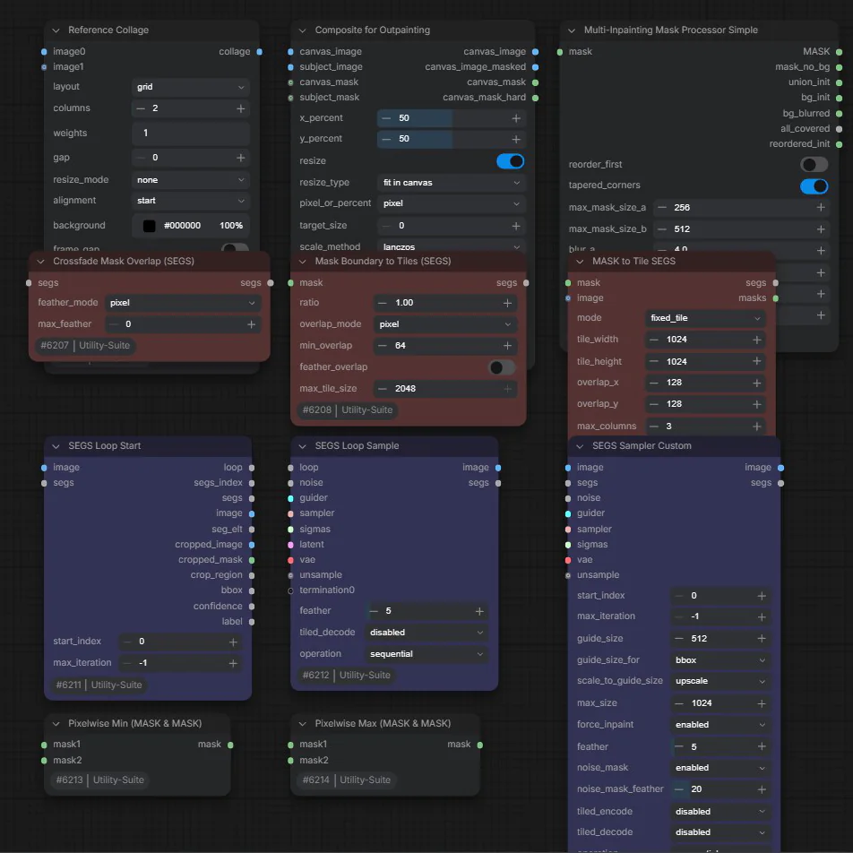
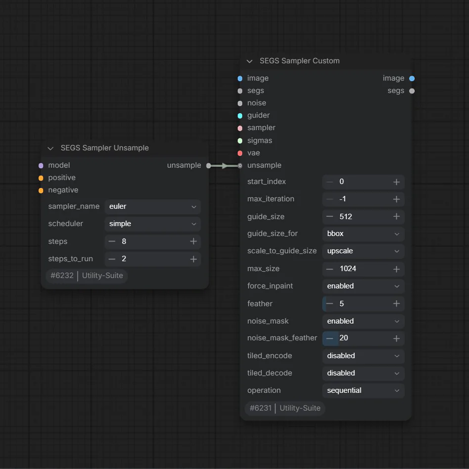
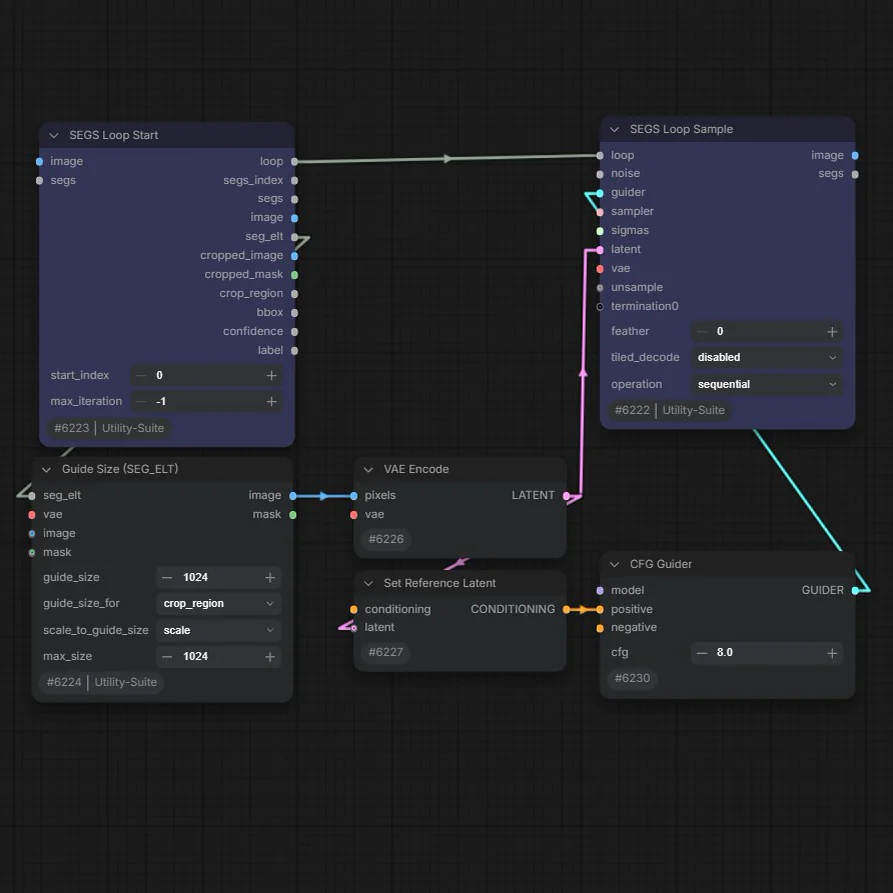
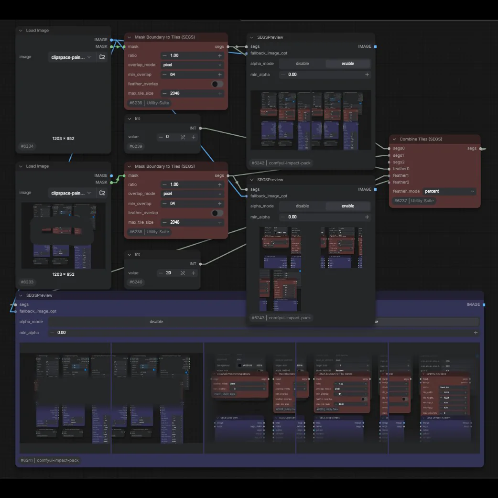
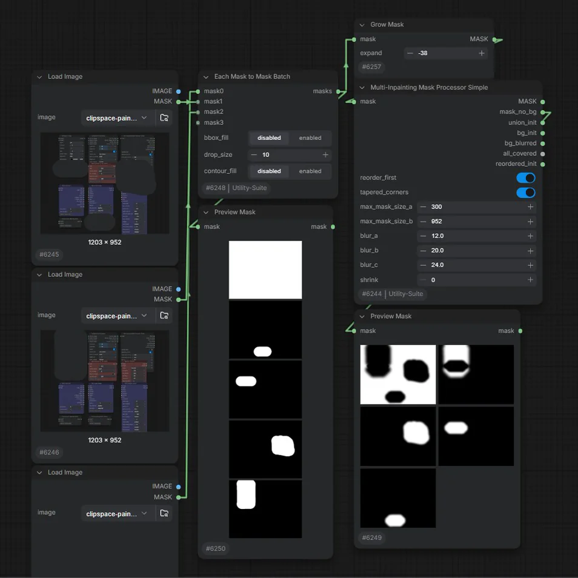
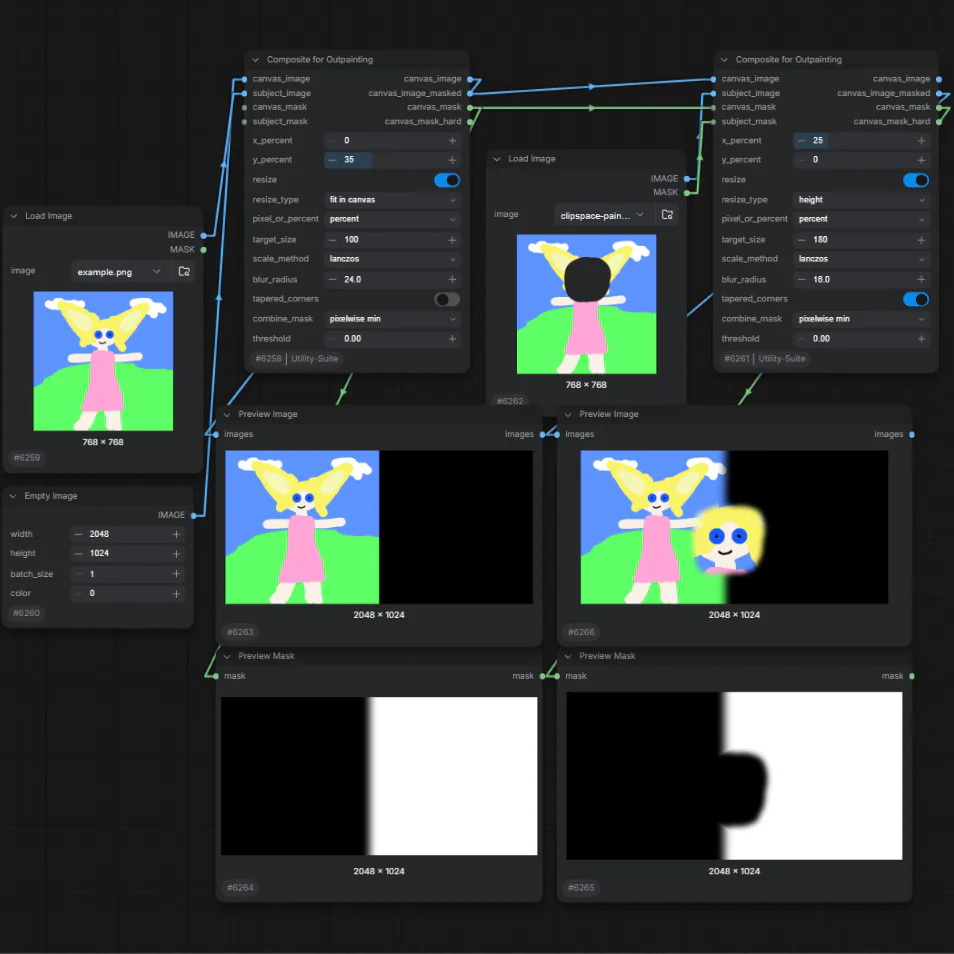
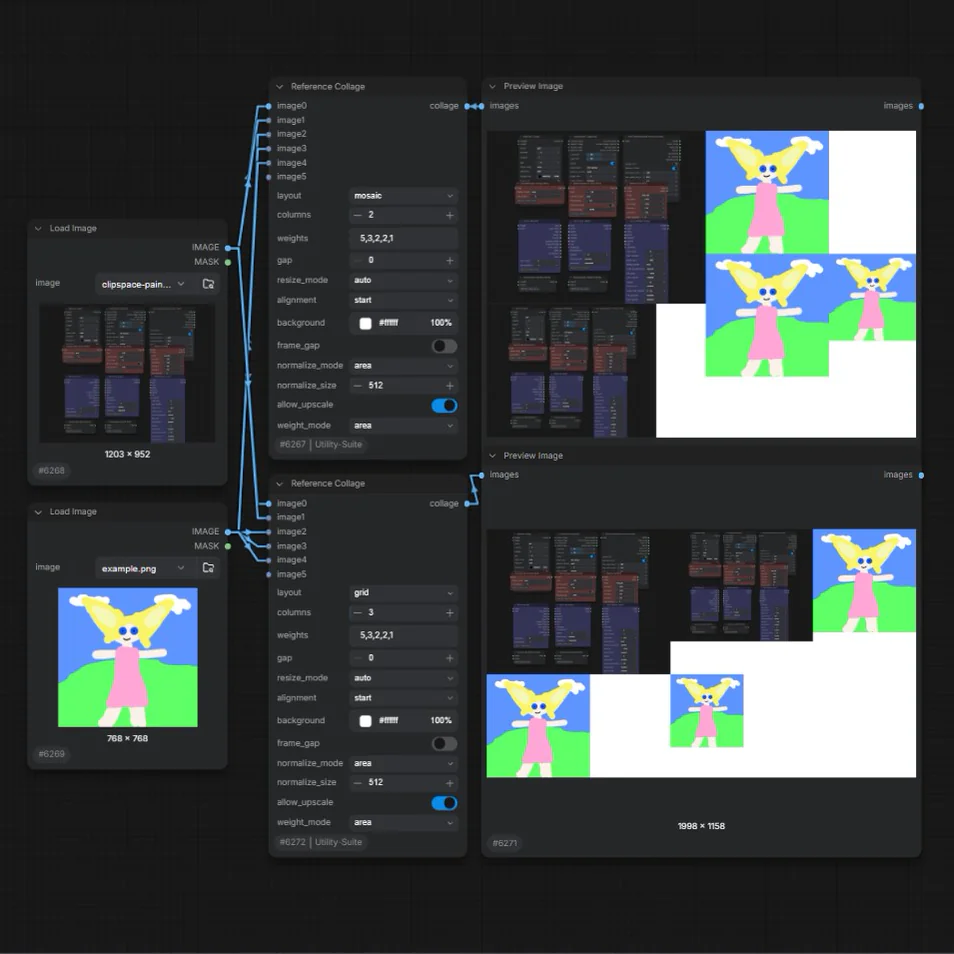

# Utility Suite

Tiling and inpainting/outpainting logics.

---

Recommended addition:
- Impact Pack

## SEGS Sampler Custom

`SEGS Sampler Custom` enhances Impact-compatible SEGS with ComfyUI's separate
`NOISE`, `GUIDER`, `SAMPLER`, and `SIGMAS` components. `sequential` processes
each crop from the progressively updated canvas. `individual` enhances stored
or original crops independently, then pastes them in SEG order.

Widget defaults are `guide_size=512`, `guide_size_for=bbox`,
`scale_to_guide_size=upscale`, `max_size=1024`, `force_inpaint=enabled`,
`feather=5`, `noise_mask=enabled`, `noise_mask_feather=20`,
`tiled_encode=disabled`, `tiled_decode=disabled`, and `operation=sequential`.

## SEGS Sampler Unsample

`SEGS Sampler Unsample` configures an optional reverse-then-forward diffusion
pass for `SEGS Loop Sample`. It raises a crop from low noise to the selected
sigma level with CFG 1, then resamples it using the loop's normal controls.
`steps_to_run=-1` uses the full schedule; reverse execution currently supports
the Euler sampler only.

## SEGS Loop

`SEGS Loop` (displayed as `SEGS Loop Start`) runs the nodes between it and a
loop-ending node once for each SEG. It exposes the current SEG, crop, mask,
index, and metadata so each region can have its own processing path.
`start_index` skips earlier entries; `max_iteration=-1` processes all remaining
entries.

## SEGS Loop Sample

`SEGS Loop Sample` ends a SEGS loop by sampling the current crop, decoding it,
and returning the updated image and SEGS. `sequential` lets later overlapping
regions see earlier edits, while `individual` processes stored crops separately
and pastes them all at the end. Connect a `SEGS Sampler Unsample` output to
optionally unsample each crop before the normal sampling pass.

## Guide Size (SEG_ELT)

`Guide Size (SEG_ELT)` resizes one SEG crop and mask to a sampling-friendly
resolution. The guide size represents the square root of a target pixel area,
measured from either the SEG bbox or crop region; it is not a fixed width or
height. Scaling respects the connected VAE's spatial compression ratio and
`max_size`; `none` returns the original dimensions unchanged.

## SEGPaste

`SEGPaste` replaces one SEG's stored crop with a processed image and optionally
pastes it onto a full-size image. The crop is resized to the SEG's crop region,
blended through its existing cropped mask, and softened by `feather`. With no
full image connected, the updated SEGS is still returned for later use.

## SEGS Loop Pass

`SEGS Loop Pass` ends a SEGS loop without sampling. Use it when the loop body
already updates the SEGS, and optionally the full image, by other means. Any
connected `termination` outputs are forced to run once per iteration, which is
useful for previews or other side effects.

## MASK to Tile SEGS

`MASK to Tile SEGS` divides one mask canvas into overlapping tile SEGS and also
returns the same crops as a mask batch. Choose fixed-size tiles, a grid bounded
by maximum rows and columns, or a uniform grid with minimum rows, columns, and
overlap. Connecting an image stores the matching image crop in every SEG.

## Mask Boundary to Tiles (SEGS)

`Mask Boundary to Tiles (SEGS)` finds each mask's union bounding box and fills
that exact boundary with width-to-height-ratio tiles. It never expands or
shrinks the detected boundary. Overlap may be specified in pixels or percent,
and `feather_overlap` creates complementary tile masks for smoother recombining.

## SEGS Change Ratio

`SEGS Change Ratio` expands each SEG crop region to a requested width-to-height
ratio while keeping it within the source canvas. Enable `tiling` when a region
must be split to stay below `max_tile_size`; overlap and optional overlap
feathering then control how those tiles meet.

## Crossfade Mask Overlap (SEGS)

`Crossfade Mask Overlap (SEGS)` changes SEG cropped masks so neighboring crop
regions crossfade across their shared area. Feather width may be given in
pixels or as a percentage of the overlap, with `max_feather=0` using the full
overlap. Crop regions and other SEG metadata are left unchanged.

## Multi-Inpainting Mask Processor Simple

`Multi-Inpainting Mask Processor Simple` turns a batch of nested or overlapping
masks into a non-overlapping sequence for staged inpainting. It adds the
background as the first mask, chooses blur strength from mask size, and can
shrink masks or taper blur corners. The extra outputs expose the foreground
partition, original union/background, processed background, coverage status,
and cleaned input order for inspection.

## Composite for Outpainting

`Composite for Outpainting` places and optionally resizes a subject on a canvas
using percentage-based alignment, then builds soft and thresholded hard masks
for outpainting. Optional canvas and subject masks control the reusable area;
blur and tapered corners soften its boundary. It returns the plain composite,
a mask-applied preview, the soft mask, and the hard mask.

## Batch MASK to SEGS with Comparison

`Batch MASK to SEGS with Comparison` creates one SEG for each mask in a batch.
Normally `crop_factor` expands each crop around its target bounds; with
`mask_base` connected, comparison masks can instead establish a larger crop at
the offset selected by `start_comparison`. `bbox_fill` fills target boxes and
`contour_fill` fills outer contours before the cropped masks are stored.

## Reference Collage

`Reference Collage` combines its auto-growing `image0`, `image1`, ... inputs
into a content-sized grid or weighted mosaic while preserving aspect ratios and
socket order. Comma-separated weights control relative displayed area or
linear scale; normalization can first bring mixed source sizes to a common
longest side, shortest side, or approximate area. Use `gap`, `frame_gap`,
alignment, and background to control the finished canvas; `columns` applies to
grid mode only.

